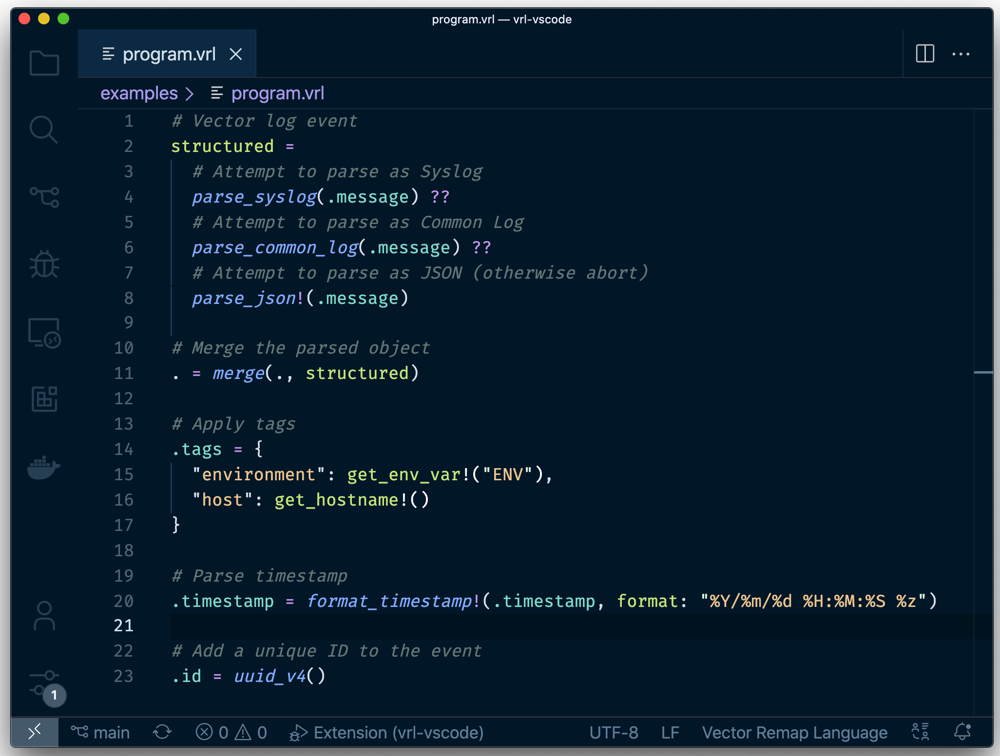

# Vector Remap Language for VS Code

> [!WARNING]
> This project is no longer maintained, and the repository is archived. The latest version on the
> [VS Code Marketplace][marketplace] is 0.1.4. Later fixes and features, such as VRL highlighting in
> YAML, are only available by [building from source](#building-from-source). For an actively
> maintained alternative, search the Marketplace for [VRL extensions][marketplace-search].

This extension adds language support for [Vector Remap Language][vrl] (VRL) to [Visual Studio
Code][vscode]. VRL is a domain-specific language (DSL) for handling observability data (logs and
metrics) that's used in conjunction with [Vector], most often in Vector's [`remap`][remap] transform
but also in transforms like [`route`][route] and [`sample`][sample].

## Screenshot



## What's included here

At the moment, language support mostly entails syntax highlighting for your `.vrl` files. I've also
included, however, [snippets] for VRL [functions]. If you begin typing the name of a built-in VRL
function, VS Code's Intellisense suggests possible completions.

### VRL in YAML

VRL embedded in YAML files, such as Vector configs and Helm values files, is highlighted too. This
applies to values of `source` and `condition` keys written as block scalars (`|`, `>`, `|-`, and so
on) or as quoted strings:

```yaml
transforms:
  parse:
    type: remap
    inputs: ["logs"]
    source: |
      . = parse_json!(.message)

  errors_only:
    type: filter
    inputs: ["parse"]
    condition: '.level == "error"'
```

Unquoted single-line values (`condition: .status == 500`) aren't highlighted, as they're
indistinguishable from ordinary YAML strings. See [`examples/vector.yaml`](./examples/vector.yaml)
for more.

I do hope to expand the feature set over time, but for now I hope that syntax highlighting and
function name Intellisense will make it easier and more fun and to write VRL!

## Building from source

To build and install the extension from the latest `main`, you need [Node.js] 22 or later:

```shell
git clone https://github.com/lucperkins/vrl-vscode
cd vrl-vscode
npm ci
npm run package
code --install-extension vrl-vscode-*.vsix
```

For [Cursor] or another VS Code fork, use its CLI in place of `code`, for example `cursor
--install-extension`. Reload the editor window afterwards. If you use [Nix], `nix develop` provides
Node.js and the other development tools.

## Development

| Command                   | What it does                                                        |
| :------------------------ | :------------------------------------------------------------------ |
| `npm test`                | Run the grammar tests in [`test`](./test), including the YAML cases |
| `npm run check`           | Lint and check formatting with [Biome]                              |
| `npm run format`          | Apply Biome's formatting and safe fixes                             |
| `npm run generate`        | Regenerate the grammar and snippets from [`templates`](./templates) |
| `npm run check:generated` | Fail if the generated files are out of date                         |
| `npm run package`         | Build a `.vsix` package                                             |

The grammar ([`syntaxes/vrl.tmLanguage.json`](./syntaxes/vrl.tmLanguage.json)) and the snippets are
generated from the templates and the list of VRL functions in
[`data/functions.json`](./data/functions.json), so edit the templates rather than the generated
files. `make fetch-vrl-data` refreshes the function list from vector.dev.

To try your changes, open this repo in VS Code and press <kbd>F5</kbd> to launch an Extension
Development Host with the extension loaded.

## Status

This project is archived and no longer maintained. The code remains available under the
[MPL-2.0](./LICENSE) license, so feel free to fork it.

[biome]: https://biomejs.dev
[marketplace]: https://marketplace.visualstudio.com/items?itemName=lucperkins.vrl-vscode
[marketplace-search]: https://marketplace.visualstudio.com/search?term=vrl&target=VSCode
[cursor]: https://cursor.com
[functions]: https://vrl.dev/functions
[nix]: https://nixos.org
[node.js]: https://nodejs.org
[remap]: https://vector.dev/docs/reference/configuration/transforms/remap
[route]: https://vector.dev/docs/reference/configuration/transforms/route
[sample]: https://vector.dev/docs/reference/configuration/transforms/sample
[snippets]: ./snippets
[vector]: https://vector.dev
[vrl]: https://vrl.dev
[vscode]: https://code.visualstudio.com
